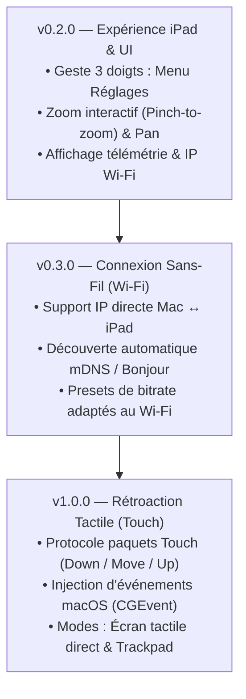

# DisplayPAD — Feuille de Route & Évolutions Techniques (Roadmap)

> Ce document récapitule les fonctionnalités planifiées pour les prochaines versions de **DisplayPAD**, leur analyse de faisabilité technique, leur impact architectural et leur ordre de priorité.

---

## 🧭 Vue d'ensemble des axes d'évolution

| Axe | Fonctionnalité | Faisabilité | Complexité | Priorité | Jalon cible |
| :--- | :--- | :---: | :---: | :---: | :---: |
| **1** | **Menu Réglages iPad (Geste 3 doigts)** | 🟢 100% | Faible | **✅ Fait** | `v0.2.0` |
| **2** | **Zoom & Déplacement interactif (Pinch-to-zoom)** | 🟢 100% | Faible à Moyenne | **✅ Fait** | `v0.2.0` |
| **3** | **Support Tactile (Touch Events iPad → Mac)** | 🟢 95% | Moyenne à Élevée | **P1 (Prochain)** | `v0.3.0` |
| **4** | **Mode Sans-fil (Wi-Fi / AWDL)** | 🟡 Limité (802.11n) | Moyenne | **⏸️ En pause** | `Backlog` |

---

## 🛠️ Analyse Détaillée par Fonctionnalité

### 1. Menu Paramètres iPad (Geste 3 doigts)
*Accéder à un panneau de configuration n'importe où sur l'écran en posant 3 doigts.*

* **Objectif** : Conserver l'immersion plein écran par défaut tout en offrant une interface de contrôle sans encombrer la zone d'affichage.
* **Geste retenu** : `UITapGestureRecognizer` avec `numberOfTouchesRequired = 3`. Ne rentre en conflit ni avec le clic simple (1 doigt), ni avec le zoom/défilement (2 doigts).
* **Contenu du menu de réglages** :
  - **Affichage & Zoom** : Bouton de réinitialisation rapide du zoom (100%), bascule Aspect Fit / Aspect Fill.
  - **Infos Réseau** : Affichage de l'adresse IP locale de l'iPad (ex: `192.168.1.45:7000`) et statut de connexion (USB vs Wi-Fi).
  - **Télémétrie en temps réel** : FPS réel reçu, résolution du flux décodé, latence ping estimée.
  - **Contrôles du flux** : Forcer une reconnexion / réinitialisation du décodeur `AVSampleBufferDisplayLayer`.
* **Faisabilité** : **100% Faisable**. Simple vue UIKit native ou `UIAlertController`/`ActionSheet` compatible iOS 12.5.

---

### 2. Zoom & Déplacement sur l'iPad (Pinch-to-zoom & Pan)
*Résoudre le problème des écritures trop petites sur l'écran 9.7" Retina.*

* **Problème identifié** : En résolution native Retina (2048×1536) ou bureau étendu, l'interface de macOS présente des textes et menus très fins.
* **Solution technique à deux niveaux** :
  1. **Zoom interactif dynamique côté iPad (Client-side Pan & Zoom)** :
     - Geste de pincement (`UIPinchGestureRecognizer`) et glissement à deux doigts (`UIPanGestureRecognizer`).
     - Application directe d'une transformation `CGAffineTransform` / `CATransform3D` sur le conteneur du layer vidéo, ou intégration dans un `UIScrollView` optimisé.
     - Double-tap rapide à 2 doigts pour revenir instantanément à l'échelle 1:1.
  2. **Résolution virtuelle HiDPI côté Mac (Server-side)** :
     - Utiliser les presets de résolution de `CGVirtualDisplay` (ex. mode HiDPI 1024×768 @2x au lieu de 2048×1536 non scalé) pour adapter la taille des polices côté macOS sans perte de netteté.
* **Faisabilité** : **100% Faisable**. Aucune modification du protocole réseau nécessaire.

---

### 3. Mode Sans-fil (Wi-Fi)
*Utiliser l'iPad comme écran secondaire sans câble Lightning/USB.*

* **Constat d'architecture actuel** :
  - `TCPReceiver.m` sur l'iPad écoute déjà sur `INADDR_ANY` (`0.0.0.0:7000`), ce qui signifie que le port 7000 est **déjà accessible en Wi-Fi**.
  - Seule l'application Mac force actuellement la connexion sur `127.0.0.1` via le tunnel `iproxy` USB.
* **Implémentation prévue** :
  - **Phase A (Manuel)** : Permettre dans les préférences du Mac d'entrer l'adresse IP de l'iPad affichée dans son menu Réglages.
  - **Phase B (Automatique via Bonjour / mDNS)** : L'iPad publie un service `_displaypad._tcp`, le Mac le découvre automatiquement via `NWBrowser` et se connecte en 1 clic sans saisie d'IP.
* **Contraintes & Risques** :
  - **Gigue et débit Wi-Fi** : En USB, la bande passante est constante et la latence < 15ms. En Wi-Fi 2.4 GHz saturé, un débit trop élevé peut saturer le buffer TCP.
  - **Stratégie** : Proposer un profil de débit adapté en Wi-Fi (8–12 Mbps au lieu de 20–25 Mbps en USB) et conserver l'USB comme option ultra-rapide par défaut.
* **Faisabilité** : **95% Faisable** (seul le Wi-Fi local de qualité peut impacter les performances de fluidité).

---

### 4. Support Tactile (Touch Events iPad → Mac)
*Transformer l'iPad en écran tactile ou trackpad pour Mac.*

* **Principe de fonctionnement** :
  1. **Capture iPad** : Intercepter `touchesBegan:`, `touchesMoved:`, `touchesEnded:` à 1 doigt sur `DisplayViewController`.
  2. **Normalisation** : Convertir les coordonnées écran en ratio normalisé `(0.0 à 1.0)` en tenant compte du zoom éventuel.
  3. **Protocole réseau (`Protocol.h`)** :
     - Définition des paquets `DP_TYPE_TOUCH_DOWN`, `DP_TYPE_TOUCH_MOVE`, `DP_TYPE_TOUCH_UP`.
     - Structure `DPTouchPayload` contenant l'ID du point de contact, les coordonnées et le type d'action.
  4. **Injection macOS** :
     - Réception dans `ConnectionManager.swift`.
     - Injection des clics et mouvements de souris via `CGEventCreateMouseEvent` et `CGEventPost(kCGHIDEventTap, ...)`.
* **Contraintes & Sécurité macOS** :
  - Requiert l'autorisation utilisateur dans *Réglages Système > Confidentialité et sécurité > Accessibilité* (`AXIsProcessTrusted()`).
* **Faisabilité** : **90% Faisable** (nécessite une gestion soignée du mapping des coordonnées avec le moniteur virtuel secondaire).

---

## 📅 Calendrier des Jalons & Ordre d'Exécution

### Prochaine étape recommandée :
Démarrer par le **Jalon v0.2.0** :
1. Intégrer la détection du geste 3 doigts sur l'iPad pour ouvrir une vue de configuration.
2. Ajouter le pinch-to-zoom (2 doigts) pour grossir les textes du Mac.
3. Afficher l'IP Wi-Fi sur l'iPad pour préparer immédiatement le test de streaming sans fil.
